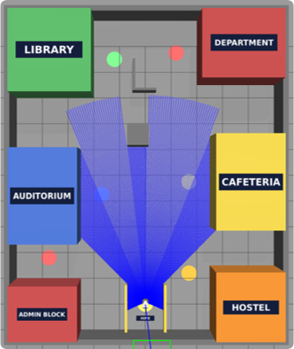
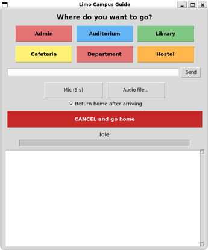
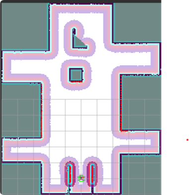

# AgileX Limo Campus Guide Robot (ROS 2 Humble, simulation)

A simulated AgileX Limo that maps a mini-campus by itself (SLAM Toolbox + explore_lite), then guides a
visitor to a destination chosen by button, typed text or voice (offline faster-whisper), waits, and returns home.

**Real-robot version (AgileX Limo Pro, ROS 2 Foxy):** https://github.com/mmuzaffark/limo-pro-lab-guide-robot
**Demo video (real robot):** https://youtu.be/WnRJRKCcmM4

This repository is a fork of [Kazimbalti/limo_ros2](https://github.com/Kazimbalti/limo_ros2) (original README: `README_upstream.md`).

## Screenshots
| Mini-campus in Gazebo (lidar view) | Guide GUI | Costmap on the SLAM map (RViz2) |
|---|---|---|
|  |  |  |

## Features
- Generated mini-campus world (12 m x 10 m, 6 named buildings, home bay), exact reference map and places file
- Autonomous mapping: SLAM Toolbox (online async) + explore_lite; the robot returns home when done
- Localization: AMCL on the robot-built map
- Navigation: Nav2 with Smac Planner 2D (centre-line, keeps away from walls) + Regulated Pure Pursuit
- Guide: trip state machine (go, announce, wait, return home; optional stay), fuzzy place/alias matching
- Voice: faster-whisper base.en on CPU; audio files (wav/m4a/mp3) or microphone
- GUI (Tkinter): building buttons, text box, audio file, mic, "return home" option, cancel
- One-command demo with Gazebo view and RViz2

## Requirements
Ubuntu 22.04, ROS 2 Humble, Gazebo Classic 11, navigation2 (incl. nav2_smac_planner), slam_toolbox,
rmw_cyclonedds_cpp, python3-tk, ffmpeg. Python: faster-whisper, rapidfuzz, numpy, pyyaml, pillow.
Tested on WSL2 (Windows 11) with an RTX A6000.

## Setup
```bash
git clone https://github.com/mmuzaffark/limo-ros2-campus-guide-robot.git ~/limo_ws
cd ~/limo_ws/src && git clone https://github.com/robo-friends/m-explore-ros2.git
cd ~/limo_ws && rosdep install --from-paths src --ignore-src -r -y && colcon build --symlink-install
cp tools/*.sh tools/*.py ~/          # scripts expect to run from the home folder
python3 make_mini_campus.py && python3 ~/add_labels.py
```

## Run
```bash
source ~/env.sh
bash ~/demo_slam.sh                  # sim + Nav2 (SLAM map) + Gazebo + RViz2 + guide GUI
NO_RVIZ=1 bash ~/demo_slam.sh        # without RViz2
bash ~/cleanup.sh                    # stop everything
```
Autonomous mapping:
```bash
bash ~/start_slam.sh
ros2 run explore_lite explore --ros-args --params-file ~/limo_ws/params/explore_campus.yaml -p use_sim_time:=true
ros2 run nav2_map_server map_saver_cli -f ~/limo_ws/maps/campus_slam --free 0.196 --ros-args -p use_sim_time:=true
```
Text / voice without the GUI:
```bash
python3 ~/limo_ws/guide/guide_manager.py --once "take me to the library" [--no-return]
python3 ~/limo_ws/guide/voice_guide.py --wav clips/Library.wav [--no-return]
```

## Navigation configurations (`params/`)
| File | Planner / controller | Inflation (local / global) | Notes |
|---|---|---|---|
| `nav2_campus_rpp_centre.yaml` | Smac 2D (cost_travel_multiplier 3.0) + RPP | 0.30 / 0.55 (scaling 5.0 / 3.0) | **Default** in `demo_slam.sh`: paths keep to lane centres |
| `nav2_campus_rpp.yaml` | NavFn + RPP | 0.30 / 0.30 | Tested baseline |
| `nav2_campus_rpp_wall.yaml` | NavFn + RPP (cost-regulated speed) | 0.45 / 0.45 | Experimental, too conservative |
| `nav2_campus.yaml` | NavFn + DWB | 0.45 / 0.45 | Original; DWB deadlocked on some routes |

Switch with: `sed -i 's#nav2_campus_rpp[a-z_]*\.yaml#<file>#' ~/demo_slam.sh`

## Results (simulation, Gazebo ground truth)
- Autonomous mapping complete in about 9 min (76 m2); the robot returned home
- AMCL error on the SLAM map: mean 0.021 m, max 0.055 m (2,949 samples)
- NavFn + RPP: all 7 destinations reached from home; gate 6/6, parking 0.094-0.133 m
- Higher wall cost (inflation 0.45): hostel path wall clearance 0.31 -> 0.46 m, gate 6/6
- Voice clips transcribed and routed correctly (~0.6 s per clip)

Limitation: simulated odometry equals ground truth, so drift is not tested here (see the real-robot repo).

## Layout
`guide/` guide logic and voice front-end · `tools/` launch, test and GUI scripts · `params/` Nav2, SLAM,
explore, places · `maps/` exact and SLAM maps · `worlds_local/` generated world · `labels/` roof labels ·
`clips/` voice commands · `docs/` screenshots · `src/` Limo packages (forked) · `THIRD_PARTY.md` external packages

Note: roof-label textures use an absolute path (`/home/muzaffar/limo_ws/labels`); rerun `add_labels.py` after cloning.
